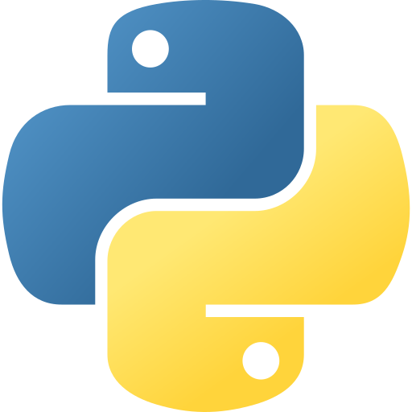
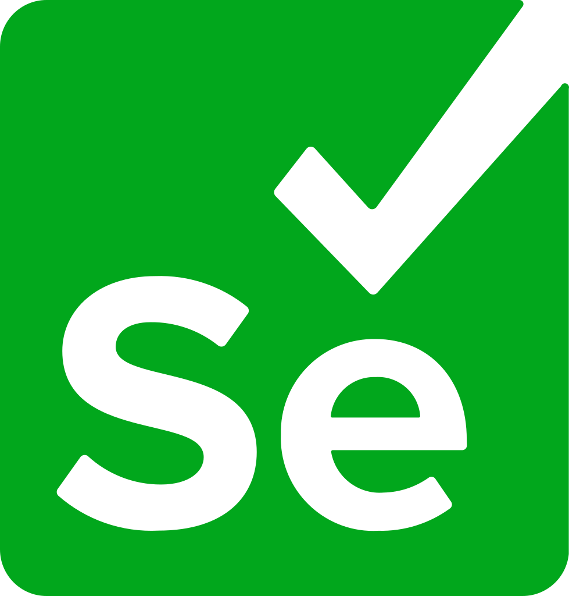
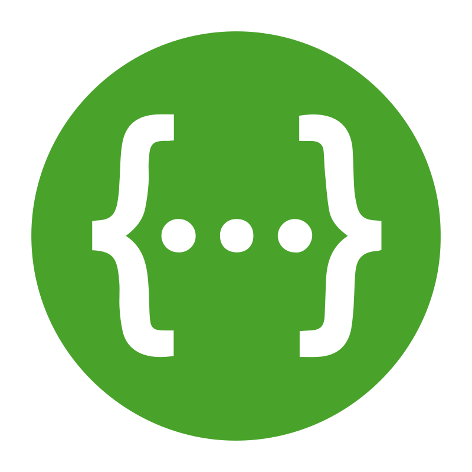
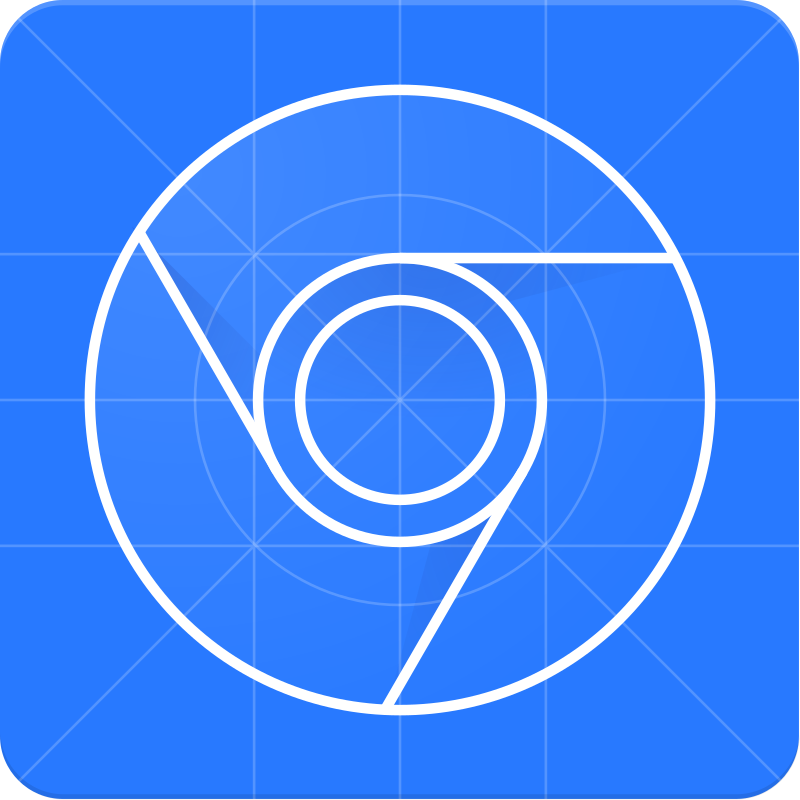
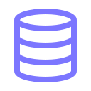

# Hi there 😼 

### I'm Taty, QA Engineer in progress

### ₊✧ ˗ˋˏ **Обо мне** ˎˊ˗ ✧₊

#### Я Татьяна, начинающий QA-инженер/тестировщик с фокусом на web-приложениях. В этом портфолио представлены мои учебные практические проекты:

<table>
<tr><td>
✦ Ручное тестирование реального e-commerce сайта <a href="">TeaSpot</a>
</td>
</tr>

<tr><td>
✦ Проект по автоматизации тестирования UI на Python, покрывающий автотестами различные типы веб-элементов на учебной платформе <a href="">QA Playground</a>
</td>
</tr>

<tr><td>
<i>+ В планах на ближайшее время - пополнить портфолио API-фреймворком для автоматизированного тестирования бэкенда</i>
</td>
</tr>
</table>
<!--    -->

### ₊✧ ˗ˋˏ **Инструменты и технологии** ˎˊ˗ ✧₊

<ul>
  <li style="display: inline;">
    </img>Python</img>
    </img>Pytest</img>
    </img>Selenium</img>
    </img>Allure</img>
    </img>Git
  </li>
</ul>
<ul>
  <li style="display: inline;">
    </img>RestAPI</img>
    </img>Postman</img>
    </img>DevTools</img>
    </img>Jira</img>
    </img>SQL
  </li>
</ul>
  

<!--    -->

### ₊✧ ˗ˋˏ **Проекты** ˎˊ˗ ✧₊

<table border=0 width="70%">
    <tr align="center">
        <td style="width:50%">
            
        </td>
        <td style="width:50%">
            
        </td>
    </tr>
    <tr align="center">
        <td>
            <b>E-COMMERCE MANUAL TESTING</b>
        </td>
        <td>
            <b>PYTHON · PAGE OBJECT MODEL</b>
        </td>
    </tr>
    <tr align="center">
        <td>
            <i>Чек-листы, тест-кейсы и баг-репорты
            для веб-приложения TeaSpot</i>
        </td>
        <td>
            <i>Фреймворк для тестирования UI элементов платформы QA Playground</i>
        </td>
    </tr>
    <tr align="center">
        <td>
            
        </td>
        <td>
            
        </td>
    </tr>
</table>

<!--    -->

### ₊✧ ˗ˋˏ **Связаться со мной** ˎˊ˗ ✧₊

<!--  -->

---
Спасибо, что заглянули!

